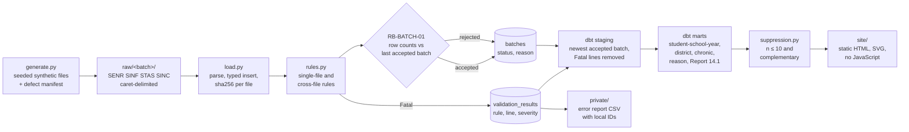

# Architecture

A batch pipeline in five layers. One command (`k12att demo`) runs all of them locally; CI
runs the same command and deploys the dashboard to GitHub Pages.

## Layers

| Layer | Code | Store | Notes |
| --- | --- | --- | --- |
| Generate | `src/k12att/generate.py` | `data/raw/<batch>/` | Seeded. Writes `manifest.json` listing every injected defect. |
| Land and parse | `src/k12att/load.py` | DuckDB `raw_files`, `senr`, `sinf`, `stas`, `sinc` | One transaction per batch; delete then insert, so reloads are idempotent. |
| Validate | `src/k12att/rules.py` | DuckDB `validation_results`, `batches` | Rules are data: ID, severity, SQL. |
| Model | `dbt/models/` | DuckDB tables | Definitions passed in from `constants.py` as dbt vars. |
| Publish | `src/k12att/publish.py`, `suppression.py` | `site/`, `private/` | Only suppressed aggregates are public. |

## Demo batches

| Batch | What it simulates | Result |
| --- | --- | --- |
| 2026-06-15 | First end-of-year submission with injected defects | Accepted; Fatal rows quarantined |
| 2026-06-22 | Corrected resubmission | Accepted; becomes the reported batch |
| 2026-06-29 | Partial extract: Grove High lost 60% of its rows | Rejected by RB-BATCH-01; reports stay on 2026-06-22 |

## Decisions

See `docs/adr/`.
